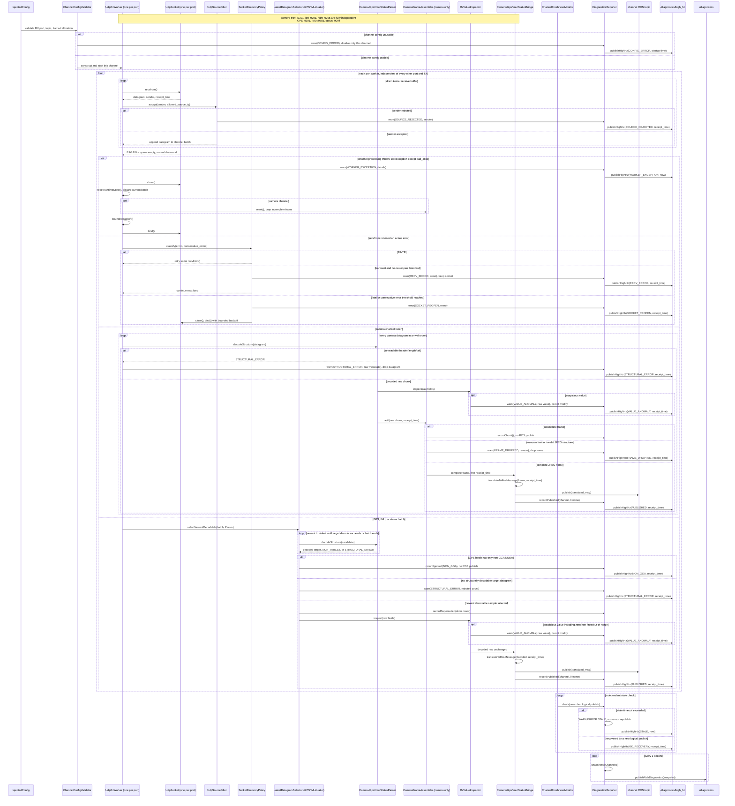
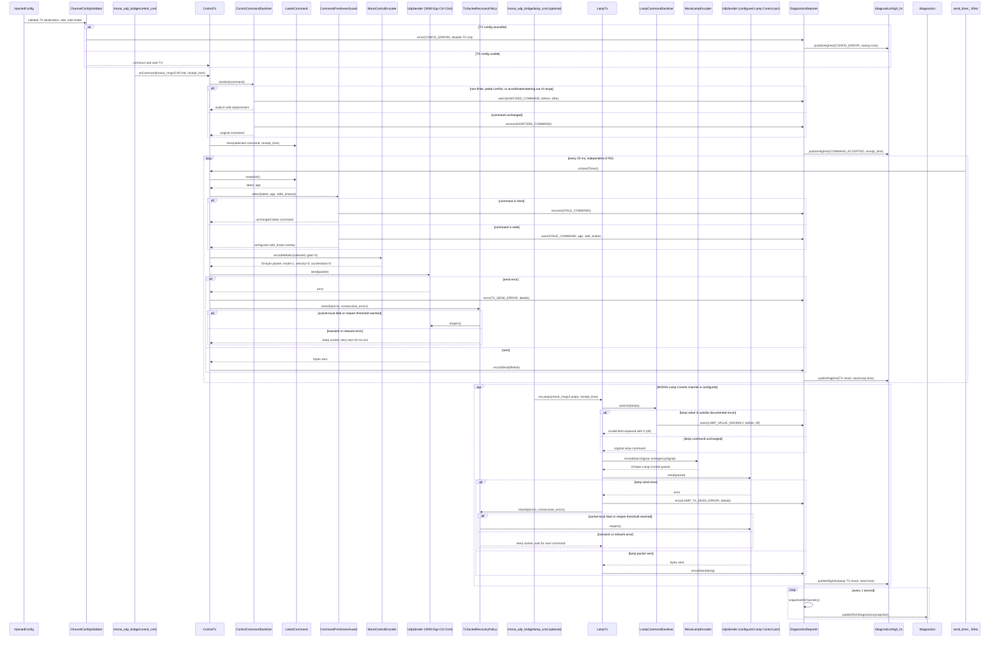

# MORAI-UDP-Bridge-Node

MORAI SIM과 ROS 사이의 UDP wire 실행 노드다. 센서 RX와 제어 TX만 담당한다.
추종, 로컬라이제이션, 조이스틱 매핑, LiDAR decode는 이 패키지에 두지 않는다.

지원 simulator/wire 기준은 대회 배포판 **`25.S4.MolitComp03` 단일 버전**이다.
다른 MORAI 버전의 비슷한 packet layout을 자동 추측하지 않는다.

## Convention

코드·설정·스크립트 들여쓰기는 공백 4칸이다. Makefile recipe만 탭을 쓴다.

이 저장소는 메인 `catkin_ws`에 서브모듈로 붙는 **실행 패키지**다.
패키지 로컬 메시지나 `ioniq5_description`에서 frame/FOV를 읽는 방식은 legacy다.

### 패키지 종류

메인 `catkin_ws/src`의 패키지는 두 종류뿐이다.

- 서비스 패키지: ROS 노드가 없다. 커스텀 라이브러리 또는 커스텀 메시지 정의만 둔다. 런타임 메모리 객체(노드, publisher, socket, 스레드)를 만들지 않는다. 예: `interfaces`.
- 실행 패키지: ROS 노드나 그 노드가 소유하는 메모리 객체를 만든다. 예: 이 패키지 `MORAI-UDP-Bridge-Node`.

### 의존성

실행 패키지 사이에는 패키지 의존성·소스 import·launch include를 만들지 않는다.
실행 패키지는 ROS 토픽으로만 대화한다.

허용하는 의존성은 서비스 패키지뿐이다. 프로젝트 커스텀 msg는 전부
`catkin_ws/src/interfaces`에 둔다. MORAI 공식 msg는
`catkin_ws/src/MORAI-ROS_morai_msgs`에 `beta_drive` 브랜치를 submodule로 연결해
사용하며, 이 저장소도 노드가 없는 서비스 패키지로 취급한다. 이 패키지 `msg/`에
MORAI msg를 다시 정의하지 않는다.

`MORAI-ROS_morai_msgs`의 실제 catkin package 이름은 `morai_msgs`다. ROS 표준
`sensor_msgs`, `diagnostic_msgs`, `std_msgs`, `geometry_msgs`는 ROS 배포판의
메시지 패키지이며 `morai_msgs` submodule이 대신 정의하는 것은 아니다.

### 설정

기본 운행 값은 이 패키지 [`config/config.yaml`](config/config.yaml)이다.
포트, 토픽, stale, send rate, diagnostics 주기를 여기서 관리한다.

차량 제원처럼 여러 실행 패키지가 같이 쓰는 값은 메인 `catkin_ws`의 전역
config에 두고, 전역 `run.sh`가 각 실행 패키지 config에 주입한다.
이 노드가 `ioniq5_description` YAML을 `sensor_setup`으로 직접 로드하지 않는다.

주입 예: `vehicle_spec`(최대 조향각, frame_id, 카메라 폭/높이/FOV).
주입 키는 전역 config가 권위다. 패키지 YAML의 같은 키는 기본값일 뿐이다.

### 실행

메인 `catkin_ws/run.sh`가 실행 패키지를 찾는다. 각 실행 패키지는
`launch.sh`를 패키지 루트에 둔다. 경로는 `catkin_ws/src/<실행패키지>/launch.sh`.

`launch.sh`는 자기 노드만 기동한다. 다른 실행 패키지의 launch를 호출하지 않는다.

`launch.sh`는 shell 재시작 루프를 만들지 않고 다음처럼 package launch 파일을
`exec roslaunch`한다.

```sh
#!/usr/bin/env bash
set -e
exec roslaunch morai_udp_bridge bridge.launch
```

`bridge.launch`의 node에는 `respawn="true"`, `respawn_delay="1.0"`,
`output="screen"`을 둔다. segfault, 처리하지 못한 `std::bad_alloc`, 그 밖의 비정상
종료는 프로세스가 종료되게 두고 `roslaunch`가 1초 뒤 새 프로세스로 기동한다.

```xml
<launch>
  <node pkg="morai_udp_bridge"
        type="morai_udp_bridge_node"
        name="morai_udp_bridge"
        output="screen"
        respawn="true"
        respawn_delay="1.0" />
</launch>
```

소스코드에 process respawn 구현은 필요하지 않다. 소스의 책임은 정상 종료 요청에서
`ros::ok()`를 확인하고 worker를 join하는 것뿐이다. `roslaunch` 자체가 종료되면 이
respawn도 동작하지 않으므로 메인 `run.sh`는 `launch.sh` 프로세스를 유지해야 한다.

### 이 노드

- 한 프로세스, 센서 RX 워커 스레드와 제어 TX 타이머는 비동기.
- 프로젝트 커스텀 msg는 `interfaces`, MORAI 공식 msg는 service package `morai_msgs`만 사용한다.
- 경로 추종, 속도 제어, 기어 판단은 넣지 않는다. `morai_msgs/CtrlCmd`에 gear 필드가 없으므로 wire gear는 상수 D=4로 고정한다.
- 페달이 동시에 오면 브레이크를 남기고 accel을 0으로 만든다. 조향이 범위를 넘으면 그 방향 최대각으로 자른다. 둘 다 WARN을 남기고 UDP 송신은 계속한다.
- `/diagnostics`는 1초마다 스트림별 `hz`와 `lifetime_p95_ms`를 붙인다. p95는 표본의 95%가 그 값 이하이며, 가장 오래 걸린 상위 5%의 경계값이다.

### 실행 객체와 책임

- `UdpRxWorker`: 포트 하나와 `UdpSocket` 하나를 소유하고 독립 수신 루프를 돈다. 패킷 의미를 해석하지 않는다. front/left/right 카메라도 각각 별도 worker와 socket을 가진다.
- `ChannelConfigValidator`: 시작 시 채널별 port, topic, frame/calibration과 TX 제어 상수를 검사한다. unusable config는 해당 채널만 비활성화하고 진단한다.
- `UdpSourceFilter`: `allowed_source_ip`가 설정된 경우 sender IP만 비교한다. payload를 해석하지 않는다.
- `LatestDatagramSelector`: GPS, IMU, status의 kernel backlog를 끝까지 비운 batch에서 가장 새로운 structurally decodable datagram 하나만 고른다.
- `CameraFrameAssembler`: 카메라 chunk를 도착 순서대로 받아 index로 한 JPEG frame을 조립한다. 세 카메라는 assembler도 서로 공유하지 않는다.
- `CameraParser`, `GpsParser`, `ImuParser`, `StatusParser`: header, 길이, tail/checksum처럼 필드 위치를 신뢰할 수 있는지만 검사하고 wire field를 decode한다.
- `CameraBridge`, `GpsBridge`, `ImuBridge`, `StatusBridge`: decode된 값을 문서에 적힌 표현·단위 변환만 거쳐 ROS 메시지로 1:1 번역하고 발행한다. 값 보정·clamp·추정은 하지 않는다.
- `RxValueInspector`: 0, enum 범위 밖, non-finite, 비정상 quaternion norm처럼 의심스러운 값을 WARN과 diagnostics에 기록한다. 값을 바꾸거나 publish를 막지 않는다.
- `SocketRecoveryPolicy`: `EAGAIN`, `EINTR`, 일시 오류와 지속·치명 오류를 구분하고 socket 재개방 여부만 결정한다.
- `ControlTx`: 제어 토픽 callback과 50Hz 송신 timer를 조정한다. callback 안에 검증·보정 로직을 직접 쓰지 않는다.
- `ControlCommandSanitizer`: TX 명령의 범위, brake 우선과 non-finite→0 대체를 한 번에 처리하고 변경 전후를 진단에 남긴다.
- `CommandFreshnessGuard`: `command_timeout_sec`만 검사한다. fresh면 명령을 그대로 통과시키고 stale이면 설정된 `safe_brake_command`를 적용한다. 기어를 비롯한 주행 판단은 하지 않는다.
- `MoraiControlEncoder`: 이미 선택된 제어값을 mode 1, gear D=4, velocity=0, acceleration=0 상수와 함께 55바이트 MORAI 패킷으로 직렬화할 뿐 검증·clamp·fallback을 하지 않는다.
- `DiagnosticsReporter`: 채널별 최신 상태, 카운터, 주기와 lifetime을 갱신한다. 처리 결과 직후 같은 RX/TX 경로에서 queue 1의 `/diagnostics/high_hz`를 publish하고, 1Hz timer에서는 `/diagnostics` snapshot을 publish한다.

### 장애 격리

- RX 포트마다 socket, worker thread, parser, 오류 상태를 분리한다. 한 포트의 문제는 다른 포트와 TX에 전파하지 않는다.
- header/길이/tail/checksum이 깨져 필드 위치를 신뢰할 수 없는 packet만 `STRUCTURAL_ERROR`로 버린다. 파싱된 값이 0, 범위 밖, non-finite처럼 이상해 보여도 원본 그대로 발행하고 WARN만 남긴다.
- `EAGAIN`은 nonblocking socket에 현재 더 읽을 datagram이 없다는 정상 종료 신호다. 오류나 timeout으로 집계하지 않는다. `EINTR`은 같은 호출을 재시도한다.
- 기타 recv 오류 한 번으로 socket을 닫지 않는다. 일시 오류는 같은 socket으로 계속하고, 연속 오류가 설정된 임계값을 넘거나 descriptor 자체가 무효인 경우에만 해당 socket을 bounded backoff로 다시 연다.
- worker의 channel 처리에서 `std::bad_alloc` 이외의 `std::exception`이 빠져나오면 해당 채널의 socket, 현재 batch, 연속 오류 상태, parser 임시 상태를 함께 초기화한다. 카메라는 미완성 JPEG assembler도 비운 뒤 bounded backoff로 다시 bind한다. 다른 RX 채널과 TX는 건드리지 않는다. `std::bad_alloc`과 알 수 없는 예외는 감추지 않고 프로세스를 종료해 `roslaunch` respawn에 맡긴다.
- TX 50Hz timer와 RX worker는 서로 다른 실행 경로다. RX 전체가 끊겨도 TX는 계속 돌고, TX send 실패가 RX를 멈추지 않는다.
- 반복 오류 로그는 throttle한다. 상태와 카운터 갱신은 생략하지 않는다.
- 초기 bind 실패나 socket-local 오류로 노드를 종료하지 않는다. 프로세스 종료는 `std::bad_alloc`, 알 수 없는 예외, segfault처럼 현재 process state를 더 신뢰할 수 없는 경우에만 허용하고 외부 respawn에 맡긴다.

### 진단 발행 정책

- 1Hz `DiagnosticArray`는 사람이 `rostopic echo /diagnostics`로 보는 heartbeat다. 정상 상태에서도 채널별 `hz`, `lifetime_p95_ms`, 누적 오류 횟수와 마지막 오류 시각을 제공한다.
- `/diagnostics/high_hz`는 고정 20Hz timer가 아니다. GPS/IMU/status의 논리 sample, 완성된 camera frame, TX send 결과, WARN/ERROR와 복구가 생길 때 해당 RX/TX 처리 경로가 반환하기 전에 lean status 하나를 즉시 발행한다.
- RX high-hz `DiagnosticArray.header.stamp`는 해당 `receipt_time`, TX는 send-loop 시각이다. 계산이 필요한 `hz`, percentile, 장기 누적 통계는 비운다.
- camera chunk마다 `DiagnosticArray`를 발행하지 않는다. chunk 수신은 메모리 counter만 갱신하고 완성 frame 또는 오류에서 발행한다. JPEG chunk는 초당 수백~수천 datagram이 될 수 있어 매 `recvfrom()`마다 ROS 직렬화·할당을 하면 센서 경로에 불필요한 부하가 된다.
- `/diagnostics`와 `/diagnostics/high_hz` 모두 표준 `diagnostic_msgs/DiagnosticArray`, publisher queue 1, non-latched다. 전자는 1Hz 전체 채널 snapshot, 후자는 즉시 발생한 채널 하나만 담는다.
- `DiagnosticsReporter`의 `publish()` 호출 순서는 주 데이터 publish/send 결과와 동기화한다. ROS publisher queue는 1이므로 느린 subscriber를 기다리거나 진단 event를 무한히 쌓지 않는다.

## 합의된 설계 계약

- 이 패키지는 MORAI wire 변환만 담당하는 실행 패키지다. 경로 추종, 속도 제어, 기어 판단, localization 판단을 넣지 않는다.
- 이 패키지는 전역 workspace에서 catkin_ws/src/@MORAI-UDP-Bridge_Node 로 깃 서브모듈 링크된다.
- 실행 패키지끼리 코드·launch 의존성을 만들지 않고 ROS 토픽으로만 연결한다. 커스텀 msg는 서비스 패키지 `catkin_ws/src/interfaces`에만 둔다.
- package 기본값은 `config/config.yaml`, 공용 차량 제원은 workspace 전역 config와 `run.sh` 주입값이 권위다. `ioniq5_description` 방식은 사용하지 않는다.
- RX는 포트별 socket·worker thread·오류 상태를 완전히 분리하고, TX 50Hz timer도 RX와 독립 실행한다. 한 채널 오류로 다른 채널이나 프로세스를 종료하지 않는다.
- front/left/right 카메라는 socket, worker, parser, assembler, 진단 상태까지 서로 독립이다.
- 단일 datagram 센서(GPS, IMU, status)는 socket backlog를 nonblocking으로 비운 뒤 newest-to-oldest 순서로 확인해 가장 최근의 structurally decodable datagram 하나만 처리한다. 건너뛴 datagram은 `superseded_count`로 기록한다.
- 카메라는 chunk index로 한 JPEG frame만 재조립한다. 새 frame 시작, 조립 제한시간 초과, 잘못된 `max_chunks`, SOI/EOI 불일치 시 미완성 frame 전체를 버리고 부분 JPEG는 발행하지 않는다.
- ROS 발행 queue는 실시간 센서 토픽에서 1로 두어 느린 subscriber 때문에 오래된 메시지가 쌓이지 않게 한다.
- 센서 메시지 stamp는 payload 내부 시각이 아니라 해당 datagram/frame의 로컬 `receipt_time`이다. GPS GGA UTC는 `/diagnostics`의 `gga_utc` key로만 보존한다.
- stale RX 채널은 WARN/ERROR와 `/diagnostics/high_hz`로 알릴 뿐 마지막 센서값을 재발행하거나 값을 추정하지 않는다.
- RX의 구조 검증은 header, byte length, tail/checksum처럼 필드 경계를 읽을 수 있는지만 판단한다. decode된 값은 0, 범위 밖, non-finite여도 바꾸거나 drop하지 않고 원본 발행과 WARN을 함께 수행한다.
- 명세에 적힌 정확한 표현 변환(NMEA `ddmm.mmmm`→decimal degree)과 단위 변환 외에 좌표 변환, clamp, normalization, 보간, 추정을 하지 않는다.
- TX 제어 입력은 `ControlCommandSanitizer`가 조향·페달 범위, brake 우선(`accel=0`), non-finite→0 대체를 한 분기에서 처리한 뒤에도 50Hz 송신을 계속한다. `longlCmdType`, velocity, acceleration 입력은 wire 출력에 사용하지 않으며 encoder가 항상 mode 1, velocity=0, acceleration=0을 쓴다. 변경 전후 값을 WARN 로그와 `/diagnostics/high_hz`에 남긴다.
- 제어 명령이 `command_timeout_sec`보다 오래되면 `CommandFreshnessGuard`가 설정된 safe brake를 선택한다. 진입과 복구를 WARN 로그와 `/diagnostics/high_hz`에 드러내며 기어는 변경하지 않는다.
- `MoraiControlEncoder`는 선택된 명령의 직렬화만 하며 clamp, fallback, 주행 판단을 하지 않는다.
- `/diagnostics`는 1Hz rich 전체 snapshot, `/diagnostics/high_hz`는 논리 sample·send 결과·상태 변화 직후 같은 처리 경로에서 발행하는 lean 단일 채널 상태다.
- **코드에 존재하는 모든 runtime 검증·drop·대체·clamp·fallback·retry·socket reopen 분기는 시퀀스 다이어그램에 객체, 조건, 결과 화살표로 드러나야 한다. 다이어그램에 없는 방어 코드는 구현하지 않는다. 구현 중 새 분기가 필요하면 코드를 쓰기 전에 README와 HTML 다이어그램을 먼저 수정해 사용자 확인을 받는다.**

## 잠정 확정 시퀀스

RX와 TX 시퀀스 다이어그램은 현재 설계의 **잠정 확정 구현 계약**이다.
구현할 클래스 객체, 메서드 호출, 반복 루프와 예외 경로는 아래 문서를 기준으로 한다.

- RX: 포트별 `UdpRxWorker`와 `UdpSocket`, 센서별 Bridge 객체,
  `DiagnosticsReporter`가 서로 독립적으로 동작한다.
- TX: ROS callback은 최신 명령만 저장하고, RX와 독립인 50Hz wall timer가
  freshness 검사, encode, UDP send를 수행한다.
- `publish()`의 도착점은 publisher 객체가 아니라 실제 ROS 토픽이다.
- 다이어그램과 이 README가 다르면 에이전트는 구현 전 사용자에게 보고하고 차이를 바로 잡는다. 코드에서 몰래
  fallback이나 상태 전이를 추가하지 않는다.

### RX



#### RX 객체와 메서드

| 객체 | 주요 메서드 | 책임과 구현 주의사항 |
| --- | --- | --- |
| `UdpRxWorker` | `run()`, `drainBatch()`, `resetRuntimeState()` | 포트 하나의 nonblocking socket을 `EAGAIN`까지 비운다. 단일 datagram 채널은 publish 전에 batch를 완전히 비운다. recoverable `std::exception`이면 해당 socket을 닫고 현재 batch, 연속 오류와 parser 임시 상태를 초기화한다. 카메라는 assembler도 reset한 뒤 bounded backoff로 다시 bind한다. |
| `UdpSourceFilter` | `accept(sender)` | 설정된 sender IP만 비교한다. payload 값은 판단하지 않는다. |
| `SocketRecoveryPolicy` | `classify(errno, count)` | `EAGAIN`, `EINTR`, 일시 오류, socket-local fatal 오류를 분류한다. reopen 판단 외의 센서 처리는 하지 않는다. |
| `LatestDatagramSelector` | `selectNewestDecodable(batch, parser)` | newest-to-oldest로 구조 decode를 시도해 최신 target 하나만 반환한다. 값의 타당성은 선택 기준이 아니다. |
| 각 `Parser` | `decodeStructure(datagram)` | header, length, tail/checksum과 field 경계만 검증하고 raw 값을 decode한다. 물리값을 보정하지 않는다. |
| `CameraFrameAssembler` | `add(chunk, receipt_time)` | 카메라별 chunk를 도착 순서로 조립한다. channel 간 상태를 공유하지 않는다. |
| `RxValueInspector` | `inspect(raw)` | 0, non-finite, enum 범위, quaternion norm 등을 진단하지만 값을 바꾸거나 publish를 막지 않는다. |
| 각 `Bridge` | `translateToRosMessage(decoded, receipt_time)`, `publish()` | 문서화된 표현·단위 변환만 수행하고 ROS message를 만든다. 좌표 회전, clamp, normalization, 추정은 하지 않는다. |
| `ChannelFreshnessMonitor` | `check(now, last_publish)` | stale 상태와 복구만 판정한다. 센서값을 재발행하지 않는다. |
| `DiagnosticsReporter` | `warnAndPublishHighHz()`, `recordPublishedAndPublishHighHz()`, `publishRichDiagnostics()` | 처리 결과를 갱신한 직후 같은 RX 실행 경로에서 `/diagnostics/high_hz`를 publish하고 반환한다. 1Hz rich snapshot만 timer에서 별도로 발행한다. |

### TX



#### TX 객체와 메서드

| 객체 | 주요 메서드 | 책임과 구현 주의사항 |
| --- | --- | --- |
| `ControlTx` | `onCommand()`, `onSendTimer()` | ROS callback과 50Hz 송신을 조정한다. 검증·보정·직렬화를 직접 구현하지 않는다. |
| `ControlCommandSanitizer` | `sanitize(command)` | accel/brake/steering의 non-finite를 0으로 바꾸고, 범위를 clamp하며, 페달 충돌 시 brake를 남기고 accel=0으로 만든다. 변경 시 before/after를 WARN으로 남기며 송신을 중단하지 않는다. `longlCmdType`, velocity, acceleration은 다루지 않는다. |
| `LatestCommand` | `store()`, `snapshot()` | sanitize된 최신 명령 하나와 monotonic receipt time만 보관한다. |
| `CommandFreshnessGuard` | `select(latest, age)` | fresh 명령 또는 공개된 safe-brake overlay를 선택한다. wire gear에는 관여하지 않는다. |
| `MoraiControlEncoder` | `encodeMode1(selected, gear=4)` | mode=1, gear=D(4), velocity=0, acceleration=0을 상수로 쓰고 선택된 accel/brake/steering을 55-byte packet으로 직렬화한다. 추가 fallback은 하지 않는다. |
| `LampCommandSanitizer` | `sanitize(lamps)` | 잘못된 `turnSignal` 또는 `emergencySignal` 필드만 `0=off`로 바꾸고 WARN을 남긴다. 잘못된 입력으로 비상등을 임의 점등하지 않는다. |
| `MoraiLampEncoder` | `encode(lamps)` | sanitize된 값을 33-byte packet으로 직렬화한다. |
| `TxSocketRecoveryPolicy` | `classify(errno, count)` | 일시·network 오류는 socket을 유지하고, socket-local fatal 오류나 설정된 연속 오류에서만 해당 sender를 reopen한다. control sender와 lamp sender 상태는 독립이다. |
| `DiagnosticsReporter` | `warnAndPublishHighHz()`, `recordSentAndPublishHighHz()`, `publishRichDiagnostics()` | command 처리와 UDP send 결과 직후 같은 TX 실행 경로에서 high-hz 진단을 publish한다. |

주석용 브라우저 뷰어: [`docs/udp-bridge-sequence.html`](docs/udp-bridge-sequence.html)

## 패킷-토픽 번역 명세

이 절은 구현 계획이자 wire 계약이다. 아직 C++ 구현 완료를 뜻하지 않는다.
커스텀 메시지의 실제 정의 위치는 `catkin_ws/src/interfaces/msg`이며, 구현 시 이
절의 필드명·단위와 해당 `.msg` 파일을 일치시킨다.

### 공통 wire 규칙

- MORAI의 정수와 IEEE-754 실수는 little-endian으로 읽고 쓴다.
- RX의 **구조 검증**은 `header`, 전체 datagram 길이, payload 길이,
  `tail` 또는 checksum처럼 각 필드의 byte 경계를 믿고 읽을 수 있는지만 확인한다.
  구조가 깨진 packet만 drop하며 이 분기는 RX 시퀀스에 `STRUCTURAL_ERROR`로 표시한다.
- decode된 필드의 값 검사는 **관측 전용**이다. 0, enum 범위 밖, `nsec>=1e9`,
  non-finite, 비정상 quaternion norm도 `RxValueInspector`가 WARN을 남길 뿐 원본 값을
  바꾸거나 publish를 막지 않는다.
- payload의 예약 영역은 버전마다 값이 달라질 수 있으므로 길이 계산에는 포함하되
  값이 0인지 검사하지 않는다. 예를 들어 aux 12B가 `00...00`이 아니어도 packet을
  거부하지 않고 필요하면 raw hex만 진단에 남긴다.
- ROS `header.stamp`는 simulator timestamp가 아니라 로컬 수신 시각이다.
  단일 datagram은 `recvfrom()` 직후, 카메라는 첫 chunk 수신 시각을 쓴다.
- ROS stamp에는 ROS time을 쓰고, queue age와 command freshness에는 시간 역행의
  영향을 받지 않는 monotonic steady clock을 쓴다.
- packet 안의 simulator `sec/nsec`는 MORAI가 packet에 넣은 원본 시각이다.
  `interfaces/CompetitionVehicleStatus`처럼 raw field가 있는 message에는
  `source_sec`, `source_nsec`로 복사한다. 표준 message에 대응 field가 없으면
  `DiagnosticsReporter`의 `last_source_sec`, `last_source_nsec`에 보존한다. 어느 경우도
  `header.stamp`를 대체하거나 freshness 계산에 쓰지 않는다.
- packet 필드와 ROS 필드가 직접 대응하면 그대로 복사하거나 아래 표의 단위만
  변환한다. 허용되는 변환 예는 NMEA `3723.2475,N`을 `37.3874583°`로 표현하거나
  km/h를 m/s로 바꾸는 것뿐이다. map ENU↔UTM↔WGS84 좌표 변환, 축 회전, 보정,
  clamp, normalization, 보간, 추정, covariance 생성은 하지 않는다.
- ROS 메시지에만 있는 필드는 표준의 unknown 표현을 쓴다. 부동소수점의 미제공은
  `NaN`, IMU covariance 미제공은 행렬 첫 원소 `-1`, GPS covariance 미제공은
  zero matrix + `COVARIANCE_TYPE_UNKNOWN`이다. 유효한 물리값인 `0`으로 위장하지 않는다.
- 단일 datagram 센서는 backlog를 비운 뒤 newest-to-oldest로 구조 decode를 시도해
  가장 최근의 **structurally decodable** datagram 하나를 발행한다. 값이 이상해
  보인다는 이유로 이전 packet을 대신 고르지 않는다. GPS는 non-GGA를 건너뛰고
  가장 최근의 structurally decodable GGA를 고른다.
- UDP 자체에는 재전송, 순서 보장, delivery QoS가 없다. 브릿지도 재전송하지 않는다.
  loss, supersede, parse error, stale은 진단 수치와 현재 상태로 노출한다.

### UDP socket과 backlog 정책

- RX 채널마다 `socket()`과 `bind(port)`를 따로 수행하고 전용 `UdpRxWorker`가
  `recvfrom()`을 호출한다. 공유 수신 queue나 공용 parser thread를 만들지 않는다.
- socket은 nonblocking으로 읽으며 `SO_RCVBUF`는 `receive_buffer_bytes` 기본값
  4MiB를 요청한다. 이것은 애플리케이션 FIFO가 아니라 worker가 CPU를 쓰는 동안
  kernel이 UDP datagram을 잠시 보관하는 용량이다. 실제 적용값은 시작 로그와
  `/diagnostics`에 기록한다.
- `allowed_source_ip`가 비어 있지 않으면 sender IP가 다른 datagram은 decode 전에
  버리고 `rejected_source`를 증가시킨다. 시뮬레이터 외 호스트가 같은 포트로 보낸
  packet을 차단하는 선택적 source filter이며, 빈 문자열이면 모든 sender를 허용한다.
- GPS, IMU, status는 readable callback 한 번에 `EAGAIN`까지 모두 읽고 그 batch의
  가장 최신 structurally decodable sample 하나만 publish한다. 더 오래된 sample은
  `superseded`로 센다. 마지막 datagram의 구조가 깨졌다면 한 칸씩 과거로 가서 가장
  가까운 structurally decodable packet을 찾는다.
- selection과 publish는 반드시 `EAGAIN`을 확인한 뒤 수행한다. 따라서 publish 이후
  kernel에 남아 다음 callback에서 읽히는 packet은 그 publish보다 나중에 도착한
  packet뿐이다. publish 뒤에 추가 drain을 하여 새 packet을 버리지 않는다.
- `EAGAIN`은 "지금 kernel receive buffer에 더 읽을 datagram이 없다"는 뜻이다.
  batch drain의 정상 끝이며 오류, timeout, packet loss로 세지 않는다.
- 카메라는 chunk 연속성이 필요하므로 읽은 datagram을 도착 순서대로 모두 assembler에
  넘긴다. 애플리케이션 레벨 camera packet queue는 별도로 만들지 않는다.
- bind 실패는 해당 채널만 100ms에서 최대 2s bounded backoff로 재시도한다. recv는
  `EINTR`이면 즉시 재호출하고, 기타 일시 오류 한 번에는 기존 socket을 유지한다.
  `recv_error_reopen_threshold` 연속 오류 또는 fatal descriptor 오류에서만 해당
  socket을 닫고 다시 bind한다.
- worker의 파싱·조립·번역 중 `std::bad_alloc` 이외의 `std::exception`이 경계 밖으로
  나오면 `resetRuntimeState()`가 해당 채널의 socket을 닫고 현재 batch, 연속 오류 수,
  parser 임시 상태를 폐기한다. 카메라는 미완성 JPEG assembler도 초기화한다. 누적
  diagnostics와 config는 유지하고 bounded backoff 후 다시 bind한다. 다른 채널의
  socket과 상태는 건드리지 않는다.
- 마지막 logical publish 이후 `stale_timeout`을 넘으면 채널 상태만 WARN/ERROR로
  바꾼다. 마지막 메시지 재발행, 값 보간, 다른 포트 정지는 하지 않는다.

### ROS1 transport 정책

ROS1에는 ROS2/DDS의 QoS profile이 없으므로 여기서 QoS는 queue, latch, transport,
최신값 정책을 뜻한다.

| 토픽 종류 | queue | latch | 정책 |
| --- | ---: | --- | --- |
| 카메라 image / camera_info | 1 | false | `/compressed`와 `/camera_info`를 frame마다 함께 발행하며 같은 stamp와 frame_id 사용 |
| GPS / IMU / vehicle status | 1 | false | 최신 structurally decoded sample만 유지, stale 값 재발행 금지 |
| control/lamp command subscriber | 1 | 해당 없음 | 기본 TCPROS + `tcpNoDelay`, callback 수신 시 최신 명령을 덮어씀 |
| `/diagnostics` | 1 | false | 1Hz rich heartbeat, 느린 subscriber 때문에 RX/TX를 막지 않음 |
| `/diagnostics/high_hz` | 1 | false | 논리 sample/send/상태 변화 직후 동기 호출, 이전 상태 메시지를 쌓지 않음 |

ROS1 `roscpp` subscriber는 `TransportHints().udp()`로 UDPROS를 요청할 수 있지만 이는
subscriber 쪽 선호이며 publisher 전체를 "UDP 토픽"으로 선언하는 QoS가 아니다.
이 프로젝트의 작은 control/lamp message는 손실 이점이 없고 같은 host의 TCPROS 비용도
미미하므로 기본 TCPROS에 `tcpNoDelay`만 사용한다. bridge가 MORAI에 보내는 packet은
이와 별개로 UDP 9093 및 Lamp Control UDP port를 사용한다.

### 포트와 토픽 인덱스

실제 포트는 MORAI SIM의 Network Settings / Ego Network에서 채널별로 설정한다.
이 표의 값과 [`config/config.yaml`](config/config.yaml)이 이 패키지의 기본값이다.

| 방향 | MORAI 채널 | UDP 포트 | ROS 토픽 | ROS 타입 | 기본 rate 상한 |
| --- | --- | ---: | --- | --- | ---: |
| RX | Camera front | 9291 | `/image/front/compressed` | `sensor_msgs/CompressedImage` | 30Hz |
| RX | Camera front info | 9291과 같은 frame | `/image/front/camera_info` | `sensor_msgs/CameraInfo` | image와 동일 |
| RX | Camera left | 9293 | `/image/left/compressed` | `sensor_msgs/CompressedImage` | 30Hz |
| RX | Camera left info | 9293과 같은 frame | `/image/left/camera_info` | `sensor_msgs/CameraInfo` | image와 동일 |
| RX | Camera right | 9295 | `/image/right/compressed` | `sensor_msgs/CompressedImage` | 30Hz |
| RX | Camera right info | 9295와 같은 frame | `/image/right/camera_info` | `sensor_msgs/CameraInfo` | image와 동일 |
| RX | GPS | 9301 | `/sensors/gps/fix` | `sensor_msgs/NavSatFix` | 30Hz |
| RX | IMU | 9303 | `/sensors/imu/data` | `sensor_msgs/Imu` | 50Hz |
| RX | Competition Vehicle Status | 9094 | `/vehicle/competition_status` | `interfaces/CompetitionVehicleStatus` | 50Hz |
| TX | Ego Ctrl Cmd | 9093 | `/morai_udp_bridge/control_cmd`에서 입력 | `morai_msgs/CtrlCmd` | 50Hz send |
| TX | Turn Signal Lamp Control | MORAI Network Settings에서 지정 | `/morai_udp_bridge/lamp_cmd`에서 입력 | `morai_msgs/Lamps` | command 발생 시 |
| 내부 | 진단 rich | 해당 없음 | `/diagnostics` | `diagnostic_msgs/DiagnosticArray` | 1Hz |
| 내부 | 진단 high-rate | 해당 없음 | `/diagnostics/high_hz` | `diagnostic_msgs/DiagnosticArray` | 논리 처리마다 즉시 |

### MORAI 좌표계와 각도 기준

좌표계는 packet 종류마다 기준 frame이 다르다. bridge는 아래 기준을 문서화할 뿐
frame 사이를 변환하지 않는다.

| 데이터 | 기준과 축 | 각도·부호 | bridge 정책 |
| --- | --- | --- | --- |
| MORAI map / Ground Truth | global ENU: `x=East`, `y=North`, `z=Up` | heading/yaw `0°=East`, CCW가 양수 | 원본 global 값을 쓰는 packet만 그대로 전달; ENU↔UTM 변환 없음 |
| 차량·IMU body frame | `x=Forward`, `y=Left`, `z=Up` | roll=x, pitch=y, yaw=z; CCW angular velocity가 양수 | IMU quaternion·벡터를 축 회전이나 부호 반전 없이 direct copy |
| GPS NMEA | WGS84 geodetic latitude/longitude | latitude North 양수, South 음수; longitude East 양수, West 음수 | NMEA degree-minute 표기만 decimal degree로 바꿔 `NavSatFix`에 기록 |
| MORAI GPS/map projection | 문서상 UTM zone 52N, WGS84, EPSG:32652 | Easting/Northing m | bridge는 UTM을 발행하지 않음; WGS84↔UTM은 localization/projector 책임 |
| Competition status rotation | global ENU의 roll/pitch/yaw | wire 단위 degree | 아래 명세의 명시적 degree↔radian 표현 변환만 허용 |
| Ego Ctrl steering | 차량 최대 조향각으로 정규화된 `[-1,1]` | 차량별 wire 부호는 주입된 `steering_sign`으로 고정 | 운행 중 부호를 추론하거나 자동 보정하지 않음 |

공식 기준: [MORAI 맵 좌표계](https://help-morai-sim.scrollhelp.site/ko/morai-sim-drive/24.R2/-9),
[MORAI 센서 좌표계](https://help-morai-sim.scrollhelp.site/ko/morai-sim-drive/24.R2/-8).
`frame_id`는 이 좌표 의미와 일치하도록 전역 `vehicle_spec`에서 주입한다.

### Camera packet ↔ CompressedImage / CameraInfo

front, left, right는 포트와 frame_id만 다르고 동일한 parser와 assembler 계약을 쓴다.
카메라 UDP는 JPEG 하나를 여러 datagram으로 쪼개므로 단일 datagram 센서와 달리
backlog에서 최신 packet만 고르면 안 된다.

#### Wire layout

MORAI timestamped layout은 아래와 같다. offset은 datagram 시작 기준이다.

| offset | 크기 | 타입 | 의미 |
| ---: | ---: | --- | --- |
| 0 | 3 | ASCII | `MOR` header |
| 3 | 4 | uint32 | simulator `sec` |
| 7 | 4 | uint32 | simulator raw `nsec` |
| 11 | 4 | uint32 | chunk `index` |
| 15 | 4 | uint32 | MORAI `size` |
| 19 | 가변 | bytes | JPEG chunk payload |
| N-2 | 2 | ASCII | 중간 chunk `AI`, 마지막 chunk `EI` |

구형 layout은 `sec/nsec`가 없으며 `index`가 offset 3, `size`가 offset 7,
payload가 offset 11에서 시작한다. `config.yaml`의 `packet_layout`을
`timestamped` 또는 `legacy`로 명시하며 packet 내용으로 layout을 자동 추측하지
않는다. 선택된 layout에서 offset을 추측해 복구하지 않는다. `size`는 MORAI 버전에 따라 chunk 크기 또는 전체
JPEG 크기로 해석되는 사례가 있으므로 JPEG bytes를 자르는 데 사용하지 않는다.
실제 payload는 datagram의 header와 2B tail 사이 전체이며, `size` 불일치는 WARN과
진단 raw 값으로만 남긴다.

#### 재조립과 검증

- timestamped packet은 `(sec,nsec)`를 frame key로 쓰고 frame key가 바뀌면 이전
  미완성 frame 전체를 버린다.
- chunk를 `index` map에 넣고 시작 index부터 `EI` index까지 모든 번호가 연속일
  때만 이어 붙인다. 순서가 바뀐 도착은 허용하지만 빠진 chunk는 추정하지 않는다.
- 시작 chunk는 index 0, 또는 JPEG SOI `FF D8`로 시작하는 index 1만 허용한다.
- header와 tail `AI/EI`는 구조 검증이다. `size=0`, `nsec>=1e9` 같은 값 이상은
  WARN만 남기고 chunk를 그대로 assembler에 전달한다.
- 비정상 `index`로 무한 메모리를 쓰지 않도록 `max_chunks=256`과 최대 index를
  resource guard로 적용한다. 이 경우만 현재 frame을 명시적으로 drop하며 RX
  시퀀스의 `resource limit` 분기에 해당한다.
- chunk 수가 `max_chunks=256`을 넘거나 새 frame이 시작되거나 조립 제한시간
  `0.2s`를 넘으면 현재 frame 전체를 버린다.
- 조립 결과가 SOI `FF D8`로 시작하고 EOI `FF D9`를 포함해야 한다. 첫 EOI 뒤의
  padding은 잘라내며, SOI/EOI가 없으면 발행하지 않는다.
- 손실 frame은 `dropped_frames`, 구조 오류는 `invalid_frames`, packet 오류는
  `parse_error_count`에 각각 기록한다.

#### ROS 필드 매핑

`sensor_msgs/CompressedImage`:

| ROS 필드 | 값 |
| --- | --- |
| `header.stamp` | 해당 JPEG 첫 chunk의 로컬 `receipt_time` |
| `header.frame_id` | 주입된 `camera_front_optical_frame` / `camera_left_optical_frame` / `camera_right_optical_frame` |
| `format` | `jpeg` |
| `data` | 검증과 trim이 끝난 완전한 JPEG bytes |

`sensor_msgs/CameraInfo`는 이미지가 완성될 때마다 같은 header로 함께 발행한다.

| ROS 필드 | 값 |
| --- | --- |
| `width`, `height` | 전역 `vehicle_spec` 주입값 |
| `distortion_model` | `plumb_bob` |
| `D` | distortion 정보가 없으므로 5개 0 |
| `K` | `fx=fy=width/(2*tan(horizontal_fov/2))`, `cx=width/2`, `cy=height/2` 기본값 |
| `R` | 3x3 identity |
| `P` | K와 같은 pinhole intrinsics, translation 0 |
| `binning_x`, `binning_y`, `roi` | 사용하지 않으므로 ROS 기본값 0 |

폭·높이·FOV·frame_id가 없거나 범위를 벗어나면 해당 카메라 채널만 `ERROR`로
비활성화하고 다른 RX/TX는 계속한다. 추측한 calibration을 발행하지 않는다.

### GPS NMEA packet ↔ NavSatFix

#### Wire와 문장 선택

포트 9301의 UDP payload는 하나 이상의 ASCII NMEA 0183 문장이다. 각 문장은
`$`로 시작하고 `*HH` XOR checksum으로 끝난다. talker ID가 달라도 문장 ID의
마지막 세 글자가 `GGA`이면 허용한다.

| GGA 필드 | 의미 | 사용처 |
| --- | --- | --- |
| UTC | GPS 측 시각 | `gga_utc` 진단 key만 보존, ROS stamp에는 사용하지 않음 |
| latitude + N/S | `ddmm.mmmm` | decimal degree latitude로 변환 |
| longitude + E/W | `dddmm.mmmm` | decimal degree longitude로 변환 |
| quality | 0=no fix, 양수=fix | `NavSatStatus.status`, raw 진단 key |
| satellites | 사용 위성 수 | 진단 key |
| HDOP | 수평 정밀도 저하 계수 | 진단 key, covariance를 임의 생성하지 않음 |
| altitude MSL | 평균해수면 기준 고도 m | geoid separation과 합산 |
| geoid separation | 타원체와 MSL 차이 m | ellipsoid altitude 계산 |
| DGPS age / station ID | 보정 정보 | 현재 토픽에 대응 필드 없음, 파싱 후 사용하지 않음 |

RMC는 위치·지상속도·course·날짜, GSA는 fix mode와 PDOP/HDOP/VDOP를 제공하지만
현재 controller는 속도를 competition status, 자세를 IMU/localization에서 받는다.
따라서 현재 bridge는 GGA만 `/sensors/gps/fix`로 번역하고 RMC/GSA는 정상적인
`NON_GGA`로 집계한다. non-GGA는 parse error가 아니다. GPS 음영 판단에는 GGA의
quality, satellites, HDOP와 채널 stale 상태를 사용한다.

#### ROS 필드 매핑

| `sensor_msgs/NavSatFix` 필드 | GGA source / 값 |
| --- | --- |
| `header.stamp` | GGA datagram의 로컬 `receipt_time` |
| `header.frame_id` | 주입된 `gps_link` |
| `status.service` | `NavSatStatus::SERVICE_GPS` |
| `status.status` | quality=0이면 `STATUS_NO_FIX`, quality>0이면 `STATUS_FIX` |
| `latitude`, `longitude` | 필드가 있으면 quality와 무관하게 N/E 양수, S/W 음수 decimal degree; 필드가 비었으면 `NaN` |
| `altitude` | MSL altitude와 geoid separation이 모두 있으면 합산; 필요한 필드가 비었으면 `NaN` |
| `position_covariance` | 9개 0 |
| `position_covariance_type` | `COVARIANCE_TYPE_UNKNOWN` |

quality가 0인 structurally decodable GGA도 버리지 않고 `STATUS_NO_FIX` 메시지로
발행한다. 좌표 필드가 같이 들어 있다면 좌표도 지우지 않는다. datagram에 GGA가
없으면 아무 메시지도 발행하지 않으며, checksum 또는 field boundary가 깨져 위치를
읽을 수 없을 때만 해당 datagram을 버리고 WARN과 진단을 갱신한다. 현재 controller 소비자는
`status.status`, latitude, longitude와 stamp를 사용하고 covariance는 요구하지 않는다.

`quality=0/양수`를 `NO_FIX/FIX`로 축약하는 것만으로 현재 controller의 사용 가능
여부 판단에는 충분하지만 RTK/DGPS 종류까지 구분하기에는 부족하다. 그래서 원본
GGA `quality`, `satellites`, `hdop`를 `/diagnostics`와 `/diagnostics/high_hz`에 함께
보존한다. 근거 없이 `SBAS_FIX`나 `GBAS_FIX`로 추정하지 않는다.

### IMU packet ↔ Imu

#### Wire layout

지원하는 packet은 legacy 107B와 timestamped 115B 두 종류뿐이다.
사용할 형식은 `config.yaml`의 `packet_layout`으로 고정하고 길이로 자동 전환하지 않는다.

| offset | 크기 | 타입 | 의미 |
| ---: | ---: | --- | --- |
| 0 | 9 | ASCII | `#IMUData$` |
| 9 | 4 | uint32 | MORAI data length; 버전 차이 때문에 읽되 단독 reject 조건으로 쓰지 않음 |
| 13 | 12 | reserved | auxiliary data, skip |
| 25 | 8 | timestamped만 | uint32 `sec`, uint32 `nsec` |
| 25 또는 33 | 80 | 10 x float64 | 측정값 |
| 105 또는 113 | 2 | ASCII | `\r\n` |

측정값 순서는 `orientation(w,x,y,z)`, `angular_velocity(x,y,z)`,
`linear_acceleration(x,y,z)`이다. non-finite나 quaternion norm 이상도 WARN만 남기고
wire 값을 그대로 발행한다. quaternion 정규화와 축 부호 변경은 하지 않는다.

#### ROS 필드 매핑

| `sensor_msgs/Imu` 필드 | packet source / 값 |
| --- | --- |
| `header.stamp` | datagram의 로컬 `receipt_time` |
| `header.frame_id` | 주입된 `imu_link` |
| `orientation.{w,x,y,z}` | packet quaternion direct copy |
| `angular_velocity.{x,y,z}` | packet angular velocity direct copy |
| `linear_acceleration.{x,y,z}` | packet linear acceleration direct copy |
| 세 covariance 행렬 | packet에 없으므로 각 행렬 `[0]=-1`, 나머지 0 |

packet 내부 `sec/nsec`는 raw 진단값으로만 보존하고 ROS stamp로 쓰지 않는다.
길이, header, tail이 깨져 측정값의 byte 위치를 확정할 수 없을 때만 datagram을
버린다. 값의 범위나 finite 여부로는 버리지 않는다.

### Competition Vehicle Status packet ↔ CompetitionVehicleStatus

대회용 `CompetitioninfoPublisher`의 고정 packet만 지원한다. 다른 길이를 비슷한
Ego Vehicle Status 버전으로 자동 추측하지 않는다.

#### Envelope

| offset | 크기 | 타입 | 의미 |
| ---: | ---: | --- | --- |
| 0 | 11 | ASCII | `#MoraiInfo$` |
| 11 | 4 | uint32 | payload length, 반드시 216 |
| 15 | 12 | reserved | auxiliary data, skip |
| 27 | 216 | bytes | `25.S4.MolitComp03` competition payload |
| 243 | 2 | ASCII | `\r\n` |

전체 길이는 245B여야 한다. 아래 offset은 payload 시작인 byte 27 기준이다.

| payload offset | wire 필드 | wire 타입·단위 | ROS 필드와 변환 |
| ---: | --- | --- | --- |
| 0 | `sec` | float32 raw clock | `source_sec` raw copy |
| 4 | `nsec` | float32 raw clock | `source_nsec` raw copy; 범위 밖이어도 WARN 후 발행 |
| 8 | `control_mode` | uint8 | `control_mode` |
| 9 | `gear` | uint8 | `gear` |
| 10 | `signed_velocity` | float32 km/h | `signed_velocity_mps = value/3.6` |
| 14 | `map_data_id` | int32 | `map_data_id` |
| 18 | `accel` | float32 0..1 | `accel` |
| 22 | `brake` | float32 0..1 | `brake` |
| 26,30,34 | `size_x/y/z` | float32 m | `size_x_m`, `size_y_m`, `size_z_m` |
| 38 | `overhang` | float32 m | `overhang_m` |
| 42 | `wheelbase` | float32 m | `wheelbase_m` |
| 46 | `rear_overhang` | float32 m | `rear_overhang_m` |
| 50,54,58 | `pos_x/y/z` | float32 m | 대회 미제공 필드, decode·발행하지 않음 |
| 62,66,70 | `roll/pitch/yaw` | float32 degree | `roll_rad`, `pitch_rad`, `yaw_rad` |
| 74 | `vel_x` | float32 km/h | `velocity_x_mps = value/3.6` |
| 78,82 | `vel_y/z` | float32 km/h | 대회 미제공 필드, decode·발행하지 않음 |
| 86,90,94 | `angular_velocity_x/y/z` | float32 degree/s | 각 `*_radps = value*pi/180` |
| 98,102,106 | `acceleration_x/y/z` | float32 m/s² | 대회 미제공 필드, decode·발행하지 않음 |
| 110 | `front_steer` | float32 degree | `steering_angle_rad = value*pi/180` |
| 114 | `rear_steer` | float32 degree | 현재 ROS message에 대응 필드가 없어 decode 후 사용하지 않음 |
| 118 | `link_id` | char[38] | 첫 NUL까지 ASCII `link_id` |
| 156..171 | tire lateral force 4개 | 4 x float32 | 현재 ROS message에 대응 필드가 없어 사용하지 않음 |
| 172..187 | side-slip angle 4개 | 4 x float32 | 현재 ROS message에 대응 필드가 없어 사용하지 않음 |
| 188..203 | tire cornering stiffness 4개 | 4 x float32 | 현재 ROS message에 대응 필드가 없어 사용하지 않음 |
| 204..211 | lane-boundary distance 2개 | 2 x float32 | 현재 ROS message에 대응 필드가 없어 사용하지 않음 |
| 212 | cross-track error | float32 | 현재 ROS message에 대응 필드가 없어 사용하지 않음 |

`control_mode`은 `1=Keyboard`, `2=AutoMode`, gear는 `0=M, 1=P, 2=R, 3=N,
4=D, 5=L` 값을 그대로 전달한다. `map_data_id`는 MORAI 기준 DigitalTwin map
`0..9999`, Virtual map `10000..19999` 범위다. 알려지지 않은 enum/range 값은
브릿지가 교정하지 않고 원본을 발행하면서 WARN 상태로 표시한다. Sync Mode에서는
packet timestamp가 Unix epoch가 아니라 시뮬레이터 시작 기준일 수 있으므로
`source_sec/source_nsec`는 디버깅용 raw clock domain으로만 취급한다.

`interfaces/CompetitionVehicleStatus`의 구현 필드 계약은 다음과 같다.

```text
std_msgs/Header header
float32 source_sec
float32 source_nsec
uint8 control_mode
uint8 gear
float32 signed_velocity_mps
int32 map_data_id
float32 accel
float32 brake
float32 size_x_m
float32 size_y_m
float32 size_z_m
float32 overhang_m
float32 wheelbase_m
float32 rear_overhang_m
float32 roll_rad
float32 pitch_rad
float32 yaw_rad
float32 velocity_x_mps
float32 angular_velocity_x_radps
float32 angular_velocity_y_radps
float32 angular_velocity_z_radps
float32 steering_angle_rad
string link_id
```

`header.stamp`는 local receipt time, `header.frame_id`는 주입된 `base_link`다.
packet에 offset은 있지만 현재 소비자가 사용하지 않는 position, lateral/vertical
velocity, linear acceleration, rear steer, tire force, side-slip, cornering stiffness,
lane distance와 cross-track error는 message schema에 넣지 않는다. 브릿지는 이 영역을
다른 필드로 오인해 읽지 않는다. 향후 필요하면 message 계약과 다이어그램을 먼저
변경한다. 기존 호환 message에 미제공 float 필드가 남아 있다면 `NaN`을 넣고,
유효값처럼 보이는 0을 채우지 않는다.

### CtrlCmd topic ↔ Ego Ctrl Cmd packet

#### ROS 입력

`/morai_udp_bridge/control_cmd`의 타입은 `morai_msgs/CtrlCmd`다. MORAI가 ROS 통신
모드에서 쓰는 기본 `/ctrl_cmd`와 이름을 분리하여 simulator를 ROS 모드와 UDP 모드로
동시에 잘못 설정했을 때 직접 제어와 bridge 제어를 구분할 수 있게 한다.

```text
int32 longlCmdType
float64 accel
float64 brake
float64 steering
float64 velocity
float64 acceleration
```

이 공식 message에는 gear와 `has_gear`가 없다. 따라서 이전의 optional gear 계약과
gear enum runtime 분기는 제거한다. `MoraiControlEncoder`는 코드 상수 `4`(D)를 wire
byte에 넣는다. 동적 gear가 실제로 필요해지면 MORAI 공식 message만으로는
표현할 수 없으므로 별도 명시적 gear topic 계약을 먼저 추가해야 한다.

message에 header가 없으므로 callback이 도착한 monotonic `receipt_time`과 sanitize된
최신 값 하나만 `LatestCommand`에 저장한다.

`ControlTx::onCommand()`는 orchestration만 하고 실제 처리는 별도 helper 객체
`ControlCommandSanitizer::sanitize(command)`에 둔다. C++에서 작은 private
method로 둘지 value member 객체로 둘지는 구현 재량이지만, 시퀀스와 테스트에서는
독립 책임으로 식별되어야 한다.

- wire `longlCmdType`은 입력값을 검사하거나 전달하지 않고 항상 `1=Throttle`로 쓴다.
  입력 message의 `longlCmdType`, `velocity`, `acceleration`은 무시한다.
- `accel`, `brake`는 `[0,1]`, `steering`은 MORAI wire와 같은 `[-1,1]`로 clamp한다.
- 두 페달이 동시에 양수면 brake를 유지하고 accel을 0으로 만든다.
- `accel`, `brake`, `steering`의 `NaN`, `+Inf`, `-Inf`는 0으로 대체한다.
- 값이 바뀌면 원본과 적용값을 WARN 로그와 `/diagnostics/high_hz` 상태에 남기지만
  50Hz UDP 송신은 멈추지 않는다.

이 sanitize는 RX의 1:1 번역 정책과 다른 **TX 안전 경계**이며 시퀀스에 공개된
의도적 변형이다. 예:

- 새 명령이 `accel=NaN`, `+Inf`, `-Inf`이면 `0.00`을 보내고
  `SANITIZED_COMMAND before=<raw> after=0.00`을 즉시 발행한다.
- `accel=0.40, brake=0.20`이 동시에 오면 `accel=0.00, brake=0.20`을 보낸다.
- `steering=1.20`이 오면 `1.00`으로 제한한다.
- 입력 `longlCmdType`이 무엇이든 wire에는 `1`을 쓴다. 이는 이상값 fallback이 아니라
  이 bridge의 고정된 mode 1 계약이다.

#### Freshness와 송신

RX와 독립인 50Hz wall timer가 매 tick 최신 명령 snapshot을 읽는다. age가
`command_timeout_sec=0.25` 미만이면 명령을 그대로 선택하고, 그 이상이면
`accel=0`, `steer=0`, `brake=safe_brake_command` overlay를 선택한다. stale 진입과
복구를 진단에 드러내며 마지막 throttle을 계속 보내거나 송신 자체를 끊지 않는다.
이는 **TX command stale 방어**다. RX sensor stale에서 이전 센서값을 재발행하지
않는다는 합의와 다른 경로이며, RX는 계속 마지막 값을 재발행하지 않는다.

기어는 경로·속도 상태로 판단하지 않는다. 입력 message에 gear가 없으므로 config의
fixed D=4만 사용하며 interlock이나 자동 추론은 하지 않는다.

#### 55-byte wire layout

destination은 UDP 9093이며 `MoraiControlEncoder`는 아래 직렬화만 담당한다.
공개 최신 DriveExample의 rear-steer가 추가된 59B packet은 이 대회판 wire와
호환되지 않으므로 지원하거나 자동 감지하지 않는다.

| offset | 크기 | 값 / source |
| ---: | ---: | --- |
| 0 | 14 | ASCII `#MoraiCtrlCmd$` |
| 14 | 4 | uint32 payload length `23` |
| 18 | 12 | reserved zero |
| 30 | 1 | `ctrl_mode=2` (Auto) |
| 31 | 1 | constant `4` (D) |
| 32 | 1 | constant `longlCmdType=1` (Throttle) |
| 33 | 4 | constant float32 `velocity=0` |
| 37 | 4 | constant float32 `acceleration=0` |
| 41 | 4 | float32 sanitized accel `[0,1]` |
| 45 | 4 | float32 sanitized brake `[0,1]` |
| 49 | 4 | float32 sanitized `steering`, `[-1,1]` |
| 53 | 2 | ASCII `\r\n` |

`sendto()` 오류는 해당 tick의 `TX_SEND_ERROR`를 기록한다. 일시·network 오류는 socket을
유지하고 다음 20ms tick에서 다시 송신한다. `EBADF`/`ENOTSOCK` 같은 socket-local fatal
오류 또는 설정된 연속 reopen 조건에서만 해당 sender socket을 다시 연다. UDP ACK,
응답 packet, 재전송 queue는 없다.

### Lamps topic ↔ Turn Signal Lamp Control packet

MORAI는 방향지시등과 비상등을 Ego Ctrl Cmd와 별도의 UDP message로 받는다.
`beta_drive`의 `morai_msgs/Lamps`를 `/morai_udp_bridge/lamp_cmd`에서 구독한다.
MORAI ROS 모드의 기본 lamp topic과 구분하기 위한 bridge 전용 이름이다.

```text
std_msgs/Header header
int8 turnSignal       # 0=None, 1=Left, 2=Right
int8 emergencySignal  # 0=Off, 1=On
```

MORAI Network Settings에서 Lamp Control destination port를 지정했을 때만 채널을
활성화한다. port 기본값을 임의로 만들지 않는다.

| offset | 크기 | 값 / source |
| ---: | ---: | --- |
| 0 | 13 | ASCII `#LampControl$` |
| 13 | 4 | uint32 payload length `2` |
| 17 | 12 | reserved zero |
| 29 | 1 | `turnSignal` raw byte |
| 30 | 1 | `emergencySignal` raw byte |
| 31 | 2 | ASCII `\r\n` |

범위 밖 `turnSignal` 또는 `emergencySignal`은 해당 필드만 `0=off`로 바꾸고 WARN 후
전송한다. 잘못된 입력 때문에 비상등을 임의로 켜는 것보다 예측 가능하며, 정상인 다른
필드는 유지한다. pause, scenario load, sensor control은
주행 제어가 아니라 simulator orchestration이므로 이 thin bridge에 넣지 않는다.

### 내부 상태 ↔ diagnostics 토픽

diagnostics는 MORAI packet과 짝이 없는 내부 관측 결과다. 여기서 "두 토픽"은
1Hz rich `/diagnostics`와 즉시 lean `/diagnostics/high_hz`를 뜻한다.
`DiagnosticsReporter`는 주 데이터 publish 또는 UDP send 결과를 기록한 직후 같은
실행 경로에서 `/diagnostics/high_hz`를 publish하고 반환한다. 따라서 main result와
진단 호출 순서는 대응하지만, 진단 subscriber의 처리 완료를 기다리지는 않는다.
1Hz timer는 같은 객체의 snapshot으로 `/diagnostics`를 별도 발행한다.

두 토픽의 각 `DiagnosticStatus.name`은 `morai_udp_bridge/<channel>`,
`hardware_id`는 `udp:<port>` 형식이다. `level`은 현재 `OK/WARN/ERROR`, `message`는
현재 reason이며 `DiagnosticArray.header.stamp`는 발행 시각이다.

`/diagnostics` 1Hz rich status의 `KeyValue`:

- 공통: `direction`, `channel`, `port`, `topic`, `state_since`, `last_error_time`.
- 수신: `received`, `published`, `rejected_source`, `parse_error`, `superseded`,
  `dropped`, `stale_age_ms`, `hz`, `lifetime_p95_ms`.
- 송신: `command_age_ms`, `sent`, `send_error`, `sanitized`, `stale_fallback`,
  `hz`, `lifetime_p95_ms`.
- GPS 추가: `gga_utc`, `quality`, `satellites`, `hdop`, `non_gga`.
- 카메라 추가: `chunks`, `completed_frames`, `dropped_frames`, `invalid_frames`.

`/diagnostics/high_hz` lean status에는 `channel`, `port`, `error_code`,
`last_transition_time`, `receipt_time`과 현재 상태 판단에 필요한 `stale_age_ms` 또는
`command_age_ms`만 넣는다. source timestamp가 있는 채널은 `last_source_sec`,
`last_source_nsec`도 넣는다. percentile과 rate 계산은 하지 않는다. 논리 sample,
send 결과, 오류와 복구가 생기면 해당 채널 status 하나를 같은 처리 경로에서 즉시 발행한다.
camera 성공은 chunk마다가 아니라 완성 frame마다 발행한다.

## Wire 참고 자료

패킷 종류와 필드 레이아웃은 `25.S4.MolitComp03` 대회 배포판이 최종 권위다.
공개 24.R2 문서는 센서 구조 참고용이며, Competition Vehicle Status와 Ego Ctrl Cmd는
2026 대회 저장소 및 실제 packet capture로 확인한다.

- MORAI SIM 백서: https://help-morai-sim.scrollhelp.site/?l=ko
- MORAI UDP 통신: https://help-morai-sim.scrollhelp.site/ko/morai-sim-drive/24.R2/udp-1
- MORAI 최신 NetworkModule: https://github.com/MORAI-Autonomous/MORAI-NetworkModule
- MORAI DriveExample UDP: https://github.com/MORAI-Autonomous/MORAI-DriveExample_UDP
- MORAI SensorExample: https://github.com/MORAI-Autonomous/MORAI-UDP-Network

## 용어

- UDP 소켓: `socket()` + `bind(port)`가 만든 OS 핸들. 예전에 `socket_fd_`로 적던 그것이다. 채널 이름은 포트다.
- GGA: 시각, 위도·경도, fix 품질, 위성 수, HDOP, 고도를 담는 NMEA 문장이다. 현재 `/sensors/gps/fix`의 위치 fix 원본으로 사용한다.
- RMC: 시각·날짜, 위도·경도, 지상 속도와 진행방향을 담는 최소 항법 문장이다. 버리면 GPS 기반 속도·heading은 제공하지 못한다.
- GSA: 2D/3D fix 모드, 사용 위성, PDOP/HDOP/VDOP를 담는다. 버리면 DOP 기반 정확도·covariance를 만들 수 없다.
- 현재 GPS 정책: GGA만 발행하고 RMC/GSA는 `NON_GGA`로 집계한다. 현재 controller의 속도는 competition status, 자세·방향은 IMU/localization이 제공하므로 RMC 속도·course는 중복이다. GGA의 fix quality, 위성 수, HDOP로 GPS 음영 진입과 수평 품질 저하는 감지한다. GGA UTC는 `/diagnostics`의 `gga_utc` key로 보존하고 ROS stamp는 수신 `receipt_time`을 쓴다.
- `NavSatFix.position_covariance`: ENU 축 위치 오차의 분산·공분산을 m² 단위 3x3 행렬로 담는 필드다. GGA의 HDOP만으로 3축 covariance를 정확히 만들 수 없으므로 임의 수치를 만들지 않고 `COVARIANCE_TYPE_UNKNOWN`을 사용한다. 시뮬레이터가 신뢰할 수 있는 오차 모델이나 GSA 기반 계약을 제공할 때만 채운다.
- `DiagnosticsReporter`: 로그와 통계를 갱신하고, 처리 결과 직후 같은 callback/worker에서 lean `/diagnostics/high_hz`를 publish한다. 1Hz timer에서는 rich `/diagnostics` snapshot을 발행한다.
- `CommandFreshnessGuard`: `select(latest, age)`가 age < `command_timeout_sec`이면 마지막 명령, 아니면 설정된 `safe_brake_command`를 고른다. fallback 진입·복구는 WARN 로그와 `/diagnostics/high_hz`로 노출하며 기어는 건드리지 않는다.
- sanitize: normalized steering `[-1,1]`, pedal 범위와 충돌, non-finite를 한 번에 처리한다. non-finite는 0, 페달 동시면 brake를 남기고 accel=0으로 하며 UDP 송신은 끊지 않는다.
- MoraiControlEncoder: 고른 명령을 mode 1, gear D=4, velocity=0, acceleration=0 상수와 함께 55바이트 Ego Ctrl Cmd 패킷으로 묶는 객체.
